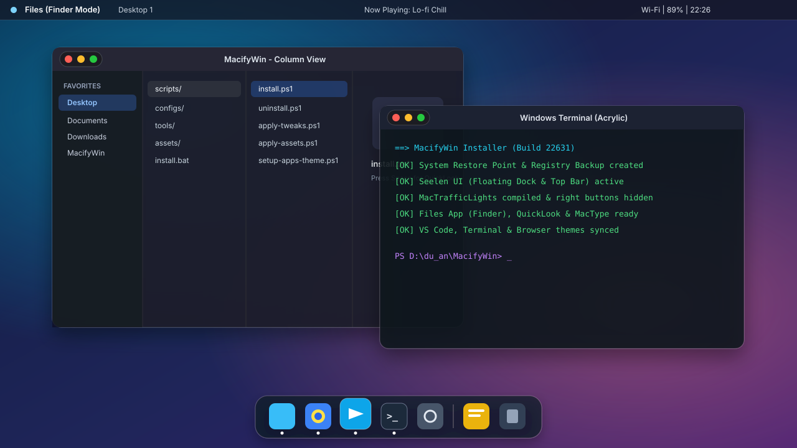

# MacifyWin

Transform **Windows 10/11** into a sleek **macOS-inspired** desktop environment—complete with a floating Dock, top Menu Bar, left-aligned Traffic Light window controls, smooth animations, Finder-style file browsing, and macOS shortcuts—with **one single command**.

- **Keeps your original app icons** (never replaces user application icons).
- **100% open-source tooling & non-Apple assets** (uses the SIL-OFL **Inter** font, LGPL **Capitaine Cursors**, and an auto-generated abstract aurora gradient wallpaper).
- **Safe & fully reversible:** Automatically creates a **System Restore Point** and backs up Registry keys & app configs before changing anything, with a 1-click `uninstall.bat`.

---

## Demo Preview



> [!NOTE]
> Above is an architectural preview of the MacifyWin layout (Top Menu Bar, centered floating Dock with Windows app icons, Column View file manager, Acrylic Terminal, and left-side Traffic Lights). You can replace `docs/images/demo-preview.svg` with your own desktop screenshot anytime.

---

## What MacifyWin Does

1. **Floating macOS-Style Dock & Top Menu Bar (`Seelen UI`):**
   - Automatically hides the native Windows taskbar (`StuckRects3`) and launches **Seelen UI** configured in compact centered `MinContent` Dock mode with rounded corners, frosted blur, and hover zoom (`zoomSize: 66`).
   - Adds a slim **Top Menu Bar** (`fancyToolbar`) displaying the active app, workspace, media controls, Wi-Fi, battery, system tray, and clock.
2. **Traffic Light Window Controls + Right-Button Mask ([`tools/MacTrafficLights.cs`](tools/MacTrafficLights.cs)):**
   - Compiled natively on install using Windows's built-in `.NET Framework csc.exe` (zero external downloads).
   - Displays clickable **Red (Close) / Yellow (Minimize) / Green (Maximize & Split-Screen Tile Left/Right menu on hover or right-click)** buttons on the top-left of active windows.
   - Automatically samples each window's titlebar color to **mask the native Windows `— □ ×` buttons on the top-right** (can be toggled anytime from the System Tray icon).
3. **Blur, Rounded Corners & Animations (`Mica For Everyone` + `Windhawk`):**
   - Applies system-wide Acrylic/Mica backdrop and rounded corners on Windows 11 (`explorer`, `Files`, `notepad`, `Taskmgr`, `WindowsTerminal`, `Code`).
   - Installs Windhawk mods (`macos-minimize-animation`, `titlebar-for-everyone`, `windows-11-start-menu-styler`, `taskbar-dock-animation`) when `windhawk-cli.exe` is available, plus smooth Registry window/scrollbar animations.
4. **Finder Experience & Quick Look (`Files App` + `QuickLook`):**
   - Installs **Files App** configured with **Column View** (`DefaultLayoutMode: 4`) and file extensions enabled, plus Explorer spacing tweaks.
   - Installs **QuickLook** so pressing **`Space`** previews images, PDFs, videos, and code instantly.
5. **Typography, Cursors & macOS Shortcuts (`Inter` + `MacType` + `AutoHotkey v2`):**
   - Downloads and installs the open-source **Inter** font family, copies a macOS-like **MacType** smoothing profile (`MacifyWin.ini`), generates an abstract gradient wallpaper (`macify-gradient.png`), and applies **Capitaine Cursors** if `.cur`/`.ani` files are placed in `assets/cursors/capitaine/`.
   - Maps `Alt` (located at the physical `⌘` key position) to macOS shortcuts (`Alt+Space` Spotlight, `Ctrl+↑` / `F3` Mission Control, `Ctrl+←/→` Spaces, `Alt+Q` Quit, `Alt+W` Close tab, `Alt+\`` cycle same-app windows, `Alt+Shift+3/4` screenshots) while **preserving `Ctrl+C/X/V/Z`**.
6. **In-App Theme Sync (`scripts/setup-apps-theme.ps1`):**
   - **VS Code:** Safely merges `Inter` font, `window.titleBarStyle: custom`, `window.commandCenter: true`, smooth scrolling/cursor, and installs `GitHub.github-vscode-theme` with automatic Dark/Light detection.
   - **Windows Terminal:** Enables translucent Acrylic background (`opacity: 85`), `useAcrylicInTabRow`, and `filledBox` cursor.
   - **Chrome & Edge:** Enables `fluent-overlay-scrollbars@1` and `windows11-mica-titlebar@1` in `Local State` (when closed).

---

## Installation (One Click)

### Step 1: Download MacifyWin

- **Option A — Download ZIP (Easiest, no Git required):**
  1. Click the green **`<> Code`** button at the top of this GitHub repository -> select **`Download ZIP`**.
  2. Right-click the downloaded `MacifyWin-main.zip` -> **`Extract All...`** (extract to a normal folder such as `D:\MacifyWin`).
- **Option B — Clone with Git:**
  ```powershell
  git clone https://github.com/<your-username>/MacifyWin.git
  cd MacifyWin
  ```

### Step 2: Run the Installer

1. **Close Google Chrome, Microsoft Edge, VS Code, and Windows Terminal** before starting (so their settings files can be updated cleanly).
2. Open the extracted `MacifyWin` folder, right-click **[`install.bat`](install.bat)** -> **`Run as administrator`**.
3. Wait 1–3 minutes while `winget` installs the required tools, compiles [`MacTrafficLights.cs`](tools/MacTrafficLights.cs), downloads the open-source **Inter** font, and applies all configs.
4. **Sign out or Restart** Windows once so fonts and MacType smoothing apply across all apps.

*(Optional Light Mode via Administrator PowerShell)*:
```powershell
powershell -ExecutionPolicy Bypass -File .\scripts\install.ps1 -Theme Light
```

---

## Tools Installed & Download Sources

You do **not** need to download these manually—[`install.bat`](install.bat) installs and configures them automatically via `winget` and official sources:

| Component | Package / Source | Purpose |
| :--- | :--- | :--- |
| **Seelen UI** | `winget`: `Seelen.SeelenUI` ([GitHub](https://github.com/eythaann/Seelen-UI)) | Floating macOS Dock & Top Menu Bar |
| **Windhawk** | `winget`: `RamenSoftware.Windhawk` ([windhawk.net](https://windhawk.net/)) | Minimize animation, Start Menu & Dock mods |
| **Files App** | `winget`: `FilesCommunity.Files` ([files.community](https://files.community/)) | Finder-style file manager with Column View |
| **QuickLook** | `winget`: `QL-Win.QuickLook` | Press `Space` to preview files instantly |
| **Mica For Everyone** | `winget`: `MicaForEveryone.MicaForEveryone` | System-wide Acrylic/Mica blur & rounded corners (Win 11) |
| **MacType** | `winget`: `MacType.MacType` | Smooth macOS-like text rendering |
| **AutoHotkey v2** | `winget`: `AutoHotkey.AutoHotkey` | MacBook keyboard shortcuts |
| **Inter Font (SIL OFL)** | Auto-downloaded from [`rsms/inter` v4.0](https://github.com/rsms/inter/releases/download/v4.0/Inter-4.0.zip) ([rsms.me/inter](https://rsms.me/inter/)) | Open-source UI & editor font |
| **Capitaine Cursors (Optional)** | [keeferrourke/capitaine-cursors](https://github.com/keeferrourke/capitaine-cursors) (LGPL-3.0) | Place converted `.cur`/`.ani` files into [`assets/cursors/capitaine/`](assets/README.md) before running `install.bat` |

---

## Uninstallation (Restore Original Windows)

Right-click **[`uninstall.bat`](uninstall.bat)** -> **Run as administrator**:
- Stops all background UI tools (`Seelen UI`, `MacTrafficLights`, `MicaForEveryone`, `AutoHotkey`, `QuickLook`, `WindhawkService`).
- Removes all MacifyWin Startup shortcuts.
- Restores your original Registry keys (taskbar `StuckRects3`, cursors, personalization, animations) and app configs (`VS Code`, `Windows Terminal`) from `%LOCALAPPDATA%\MacifyWin\backup\`.
- Prompts whether to uninstall the apps installed via `winget`.

---

## Repository Structure

```text
MacifyWin/
├── install.bat                     # 1-click admin launcher -> scripts/install.ps1
├── uninstall.bat                   # 1-click restore -> scripts/uninstall.ps1
├── LICENSE                         # MIT License
├── README.md                       # Project documentation (English)
├── tools/
│   └── MacTrafficLights.cs         # Native C# overlay for left traffic lights + right button mask
├── scripts/
│   ├── common.ps1                  # Shared helpers (OS check, restore point, backups, winget)
│   ├── install.ps1                 # Main orchestrator
│   ├── uninstall.ps1               # Clean rollback & optional package removal
│   ├── apply-tweaks.ps1            # Registry tweaks (Dark/Light, taskbar auto-hide, animations)
│   ├── apply-assets.ps1            # Inter font installer, cursors, aurora wallpaper generator
│   └── setup-apps-theme.ps1        # VS Code, Windows Terminal, Files App, Chrome/Edge patching
├── configs/
│   ├── seelen-ui/settings.json     # Centered floating Dock + Top Menu Bar preset
│   ├── windhawk/windhawk-mods.reg  # Preconfigured Windhawk mod settings
│   ├── mica-for-everyone/          # Acrylic/Mica & rounded corner rules
│   ├── mactype/MacifyWin.ini       # Smooth font rendering profile
│   ├── files-app/user_settings.json# Column View & Finder-style defaults
│   ├── vscode/settings.patch.json  # Non-destructive VS Code UI patch
│   └── autohotkey/macos-shortcuts.ahk # MacBook-style shortcuts
├── assets/                         # Open-source fonts, cursors, and generated wallpapers
└── docs/
    ├── compatibility.md            # Windows 10 vs Windows 11 support matrix
    ├── shortcuts-cheatsheet.md     # Complete shortcut & gesture reference
    ├── app-theming-guide.md        # Extra per-app styling tips
    ├── troubleshooting.md          # Common issues & fixes
    └── images/demo-preview.svg     # Demo layout illustration
```

---

## Windows Compatibility & Realistic Limitations

See [docs/compatibility.md](docs/compatibility.md) for full details:
- **Windows 11 (22H2 / 23H2 / 24H2):** Fully supported (recommended).
- **Windows 10 (21H2 / 22H2):** Supported for Seelen UI, MacTrafficLights, Files App, QuickLook, MacType, AutoHotkey, and app themes; native DWM Mica/rounded corners are skipped automatically.

### What Cannot Be 100% Identical to macOS (and Closest Workarounds)

| Limitation | Technical Reason | MacifyWin Workaround |
| :--- | :--- | :--- |
| **Custom-UI apps** (Chrome, Edge, VS Code, Discord, Spotify) | Electron/Chromium apps draw their own titlebars on the right. | `MacTrafficLights` adds left traffic lights and color-samples the titlebar to mask the right `— □ ×` buttons; Chrome/Edge/VS Code receive synchronized themes. |
| **True Global Menu Bar** (`File / Edit / View` detached from windows) | Windows embeds menus inside each app window rather than a global OS menu bar. | **Seelen UI** provides a top Menu Bar with the active app name, media, Wi-Fi, battery, tray, and clock. |
| **System-wide XAML font override** | Windows 10/11 hardcodes `Segoe UI` in modern UWP/WinUI components. | **Inter** is installed for configurable apps and **MacType** smooths text rendering across desktop apps. |
| **Native GPU Genie minimize** | Windows DWM does not provide macOS's curved Genie shader natively. | Windhawk's `macos-minimize-animation` and Registry metrics provide smooth scale/minimize transitions. |

---

## Further Documentation

- [Shortcuts & Gestures Cheatsheet](docs/shortcuts-cheatsheet.md)
- [Windows Compatibility Matrix](docs/compatibility.md)
- [Troubleshooting Guide](docs/troubleshooting.md)
- [Per-App Theming Guide](docs/app-theming-guide.md)

## License

Released under the [MIT License](LICENSE).
